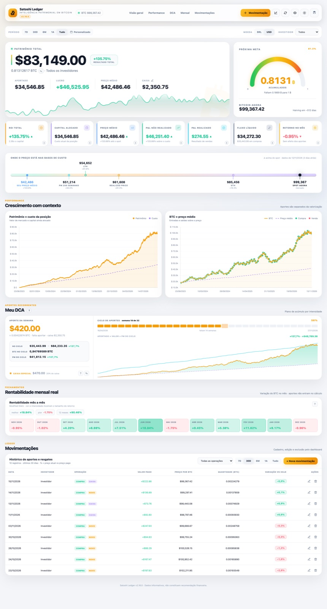
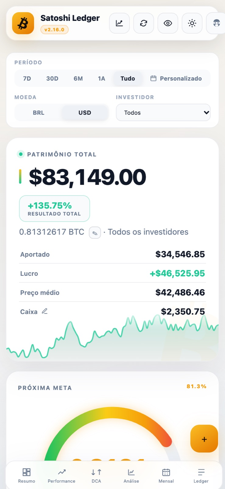
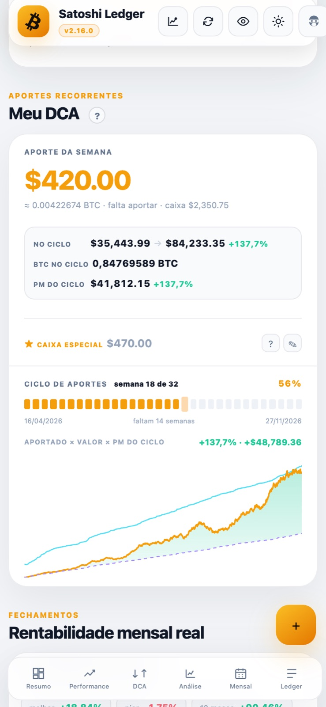
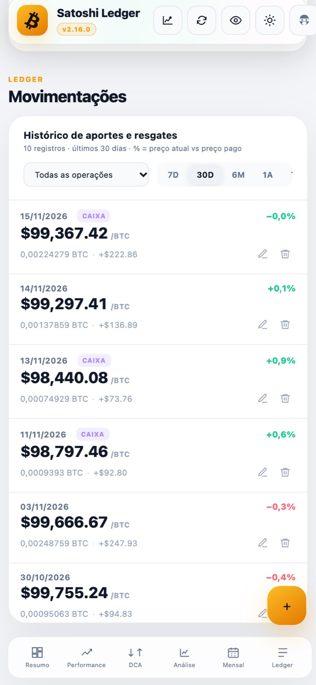

# Satoshi Ledger — controle de carteira de Bitcoin no Google Sheets

Um **dashboard completo de carteira de Bitcoin** que roda 100% dentro do Google:
a planilha é o banco de dados, o Google Apps Script é o servidor e o dashboard é
uma página web publicada por ele (funciona no computador e no celular).

Este repositório é um **guia de montagem do zero**, para quem nunca programou.
Você vai copiar dois arquivos, colar no Google, publicar e usar. Nenhuma
assinatura, nenhum servidor, nenhum cartão de crédito — só uma conta Google
(e, opcionalmente, um bot no Telegram).

> **Escopo:** o projeto é feito **exclusivamente para Bitcoin**. Não há suporte a
> outras criptomoedas, corretoras ou ativos. Tudo é contado em BTC e convertido
> para dólar e real.

---

## O que você vai ter no final

**No computador:**



**No celular:**

<p>



</p>

> Todas as imagens acima foram geradas com **dados fictícios**. Nenhum dado real
> de nenhuma pessoa aparece neste repositório.

### O que o dashboard mostra

| Seção | O que entrega |
|---|---|
| **Resumo** | patrimônio, quantidade de BTC, preço médio, lucro, aportado, caixa, ROI |
| **Bases de custo** | onde o preço está em relação a LTH, realized price, STH, seu PM, PM de 200 semanas e spot |
| **Performance** | patrimônio × custo e preço do BTC × seu preço médio |
| **DCA** | aporte da semana, cota, ciclo de 32 semanas e gráfico do ciclo |
| **Rentabilidade mensal** | mapa de calor dos últimos 12 meses |
| **Movimentações** | histórico completo com edição e exclusão |
| **Análise detalhada** | insights da carteira, do DCA e projeção de cenários |
| **Modo fiscal** | controle separado do que você declara à Receita |

---

## Antes de começar

Você precisa de:

- [ ] uma conta Google (Gmail) — é onde a planilha e o dashboard vivem
- [ ] um computador com navegador (a montagem é mais fácil no computador)
- [ ] cerca de **40 minutos** na primeira vez
- [ ] opcional: Telegram instalado no celular (para receber alertas)

Você **não** precisa de: servidor, hospedagem, domínio, cartão de crédito,
chave de API paga ou conhecimento em programação.

---

## Resumo do que fazer (leia antes de começar)

| O que | Onde | Ação |
|---|---|---|
| 4 abas com cabeçalhos | Google Sheets | **CRIAR** |
| 7 arquivos de código | Apps Script | **CRIAR + COLAR** (conteúdo de `src/`) |
| Fuso horário | Configurações do projeto | **SUBSTITUIR** (opcional) |
| Janela do DCA e % do caixa especial | `Code.gs` → `var DCA_PLAN` | **SUBSTITUIR** (opcional) |
| Token e chat id do Telegram | dashboard → Configurações | **SUBSTITUIR** (opcional) |
| Implantação do web app | Apps Script → Implantar | **CRIAR** |
| Gatilhos | criados por `setupProject` | automático |

### Mapa: qual arquivo colar em qual lugar

| Arquivo do repositório | Crie no editor como | Tipo | Obrigatório |
|---|---|---|---|
| [`src/Code.gs`](src/Code.gs) | `Code` (o `Código.gs` que já existe) | Script | **sim** |
| [`src/Dashboard.html`](src/Dashboard.html) | `Dashboard` | **HTML** | **sim** |
| [`src/Email.gs`](src/Email.gs) | `Email` | Script | **sim** |
| [`src/ResumoMensal.gs`](src/ResumoMensal.gs) | `ResumoMensal` | Script | opcional |
| [`src/GravaHistoricoDario.gs`](src/GravaHistoricoDario.gs) | `GravaHistoricoDario` | Script | opcional |
| [`src/GravaHistoricoMensal.gs`](src/GravaHistoricoMensal.gs) | `GravaHistoricoMensal` | Script | opcional |
| [`src/Cotacao.gs`](src/Cotacao.gs) | `Cotacao` | Script | opcional |

> O `src/appsscript.json` **não** é colado: ele é o manifesto do projeto (só é
> usado se você clonar com `clasp`). O fuso você ajusta em
> **Arquivo → Configurações do projeto**.

Cada documento abaixo repete esses apontamentos no ponto exato, com o bloco
**“Onde está no código”**.

---

## Passo 1 — Criar a planilha

1. Abra <https://sheets.new> (cria uma planilha em branco).
2. Renomeie para algo como **`Minha carteira BTC`**.
3. Crie as abas e cole os cabeçalhos exatamente como estão aqui:

| Aba | Cabeçalhos (linha 1) |
|---|---|
| `Aportes` | `Aporte` · `Token` · `Aporte $` · `Cotação $` · `Cotação R$` · `Qtd` · `Investidor` · `Origem` |
| `Histórico Diário` | `Data` · `Saldo USD` · `Saldo R$` · `QTD BTC` · `PM BTC` · `COTAÇÃO BTC` |
| `Histórico Mensal` | `Mês` · `Saldo USD Primeiro Dia (Mês)` · `Saldo USD Último Dia (Mês)` · `Saldo R$ Primeiro Dia (Mês)` · `Saldo R$ Último Dia (Mês)` · `Aporte / Resgate` |
| `Moedas` | `Ativo` · `Cotação` · `Símbolo` |

> A aba `IRPF` é criada sozinha na primeira execução — não precisa criar.

**Detalhe importante:** a aba `Aportes` é a única que você vai preencher à mão
(ou pelo dashboard). As outras são geradas automaticamente.

📖 Guia detalhado: [`docs/01-planilha.md`](docs/01-planilha.md)

---

## Passo 2 — Criar o projeto no Google Apps Script

1. Na planilha, menu **Extensões → Apps Script**.
2. Apague todo o conteúdo do arquivo `Código.gs`.
3. Copie o conteúdo de [`src/Code.gs`](src/Code.gs) deste repositório e cole.
4. À esquerda, em **Arquivos → + → HTML**, crie um arquivo chamado **`Dashboard`**
   (sem `.html` no nome).
5. Copie o conteúdo de [`src/Dashboard.html`](src/Dashboard.html) e cole nele.
6. Crie os demais scripts — **Arquivos → + → Script** — com estes nomes:
   `Email`, `ResumoMensal`, `GravaHistoricoDario`, `GravaHistoricoMensal`,
   `Cotacao`. Cole o arquivo de mesmo nome de `src/`.

> Só `Code`, `Dashboard` e `Email` são obrigatórios. Os outros três habilitam
> recursos opcionais (resumo no Telegram e gravação manual de histórico).

7. Salve (Ctrl/Cmd + S).

> O nome do arquivo HTML **precisa** ser exatamente `Dashboard`, porque o código
> procura por esse nome ao abrir a página.

Se preferir usar o `clasp` (linha de comando) ou quiser entender o que cada
arquivo faz: [`docs/03-apps-script.md`](docs/03-apps-script.md)

---

## Passo 3 — Configurar o projeto

1. No editor do Apps Script, selecione a função **`setupProject`** na barra
   superior e clique em **Executar** (ela está em `src/Code.gs`).
2. O Google vai pedir autorização:
   - **Revisar permissões** → escolha sua conta
   - **Avançado** → **Acessar (não seguro)** — é normal, o script é seu
   - **Permitir**
3. Volte na planilha: as abas foram formatadas, os cabeçalhos conferidos e os
   **gatilhos automáticos** criados.

Se der erro de fuso horário, ajuste em **Arquivo → Configurações do projeto →
Fuso horário** para o seu (ex.: `America/Sao_Paulo`).

📖 [`docs/03-apps-script.md`](docs/03-apps-script.md)

---

## Passo 4 — Publicar o dashboard (web app)

1. No editor do Apps Script, clique em **Implantar → Nova implantação**.
2. Tipo: **App da Web**.
3. Preencha:
   - **Descrição:** `dashboard`
   - **Executar como:** `Eu` (seu e-mail)
   - **Quem tem acesso:** `Somente eu`
4. Clique em **Implantar** e copie a **URL do app da Web**.
5. Abra a URL no navegador — o dashboard carrega vazio (ainda não há dados).

> Guarde essa URL. Ela é o seu dashboard. No celular, abra a mesma URL e use
> “Adicionar à tela de início” para virar um ícone de app.

⚠️ **Nunca** publique com acesso “Qualquer pessoa”, a menos que queira que
qualquer um com o link veja seus dados.

📖 [`docs/04-publicar.md`](docs/04-publicar.md)

---

## Passo 5 — Registrar as primeiras compras

Há dois jeitos:

**a) Pelo dashboard (recomendado)** — botão **+ Movimentação**:
- data, tipo (compra/venda), moeda informada (USD ou BRL), preço, valor,
  quantidade, investidor e **origem**.

**b) Direto na aba `Aportes`** — uma linha por operação:

| Aporte | Token | Aporte $ | Cotação $ | Cotação R$ | Qtd | Investidor | Origem |
|---|---|---|---|---|---|---|---|
| 15/01/2025 | BTC | 500 | 95000 | 515000 | 0,00526316 | Investidor | Novo |

Depois de cadastrar, clique em **Atualizar** no dashboard (ou recarregue a página).

### O que é “Origem”

| Origem | Quando usar |
|---|---|
| `Novo` | dinheiro novo entrando na carteira (padrão) |
| `Caixa` | compra usando o caixa que já está na carteira (veio de uma venda) |
| `Especial` | compra de oportunidade, usando o caixa especial (não conta na cota do DCA) |
| `Ajuste` | **não é compra**: corrige o saldo do caixa (quantidade zero) |
| `Ajuste BTC` | **não é compra**: corrige só a quantidade de BTC (sats perdidos em taxa, poeira) |

📖 [`docs/07-como-usar.md`](docs/07-como-usar.md)

---

## Passo 6 — (Opcional) Bot do Telegram

O dashboard pode te avisar toda quarta-feira qual é o aporte da semana e enviar
um resumo mensal.

1. No Telegram, fale com **@BotFather** → `/newbot` → escolha um nome → ele te dá
   um **token** (`1234567:AAA...`).
2. Mande uma mensagem qualquer para o seu bot.
3. Descubra seu **chat id** abrindo:
   `https://api.telegram.org/bot<SEU_TOKEN>/getUpdates` e procure `"chat":{"id":...}`.
4. No dashboard, abra o ícone de engrenagem (**Configurações**) e cole o token e
   o chat id. Salve.
5. Teste pelo menu da planilha: **₿ Satoshi Ledger → Enviar alerta de teste**.

📖 [`docs/06-telegram.md`](docs/06-telegram.md) — inclui como criar o bot do zero.

---

## Passo 7 — Deixar rodando sozinho

O `setupProject` já cria os gatilhos — todos definidos na função
`installTriggers_()` de `src/Code.gs`:

| Quando | O que faz |
|---|---|
| todo dia ~21h | grava o snapshot do dia no `Histórico Diário` |
| todo dia ~22h | envia o relatório mensal (só no dia 1º) |
| toda quarta ~13h | envia o aporte da semana no Telegram |

Para conferir: **Relógio (⏰) → Gatilhos** no editor do Apps Script.
Para recriar: rode `setupProject` de novo (ele não duplica).

📖 [`docs/05-triggers.md`](docs/05-triggers.md)

---

## Como o DCA funciona (resumo)

O projeto trata o **DCA por ciclo de halving**:

```
halving − 725 dias  ───────────────  halving − 500 dias
        início da janela      fim da janela (32 semanas)
```

- A **cota da semana** = caixa normal ÷ semanas restantes (valor fixo por semana).
- **Semana concluída** quando você aporta o valor da cota; ela volta ao valor
  cheio no domingo.
- O **caixa especial** (padrão 20%) é reserva manual para oportunidade e não
  entra na cota.
- A janela é calculada a partir da data estimada do próximo halving, que vem de
  uma fonte pública gratuita (altura do bloco).

📖 [`docs/08-dca.md`](docs/08-dca.md) — explicação completa, com exemplos.

---

## Modo fiscal (opcional)

Existe um “caderno separado” para o que você pretende declarar:

- marque uma compra do ledger com **“Reportar para a Receita”**, ou
- cadastre uma compra só dele, que **nunca** entra no saldo, no preço médio nem
  no patrimônio.

Ele gera uma aba `IRPF` no formato da planilha de aportes e calcula o preço
médio do que foi declarado.

📖 [`docs/09-modo-fiscal.md`](docs/09-modo-fiscal.md)

---

## Rotina de uso

| Frequência | O que fazer |
|---|---|
| a cada compra | registrar no dashboard (+ Movimentação) |
| semanal | conferir o aporte da semana no card do DCA |
| mensal | abrir a seção **Mensal** e conferir o mapa de calor |
| quando quiser | **Análise detalhada** para ver projeções e insights |

---

## Backup e recuperação

O menu **₿ Satoshi Ledger** da planilha tem:

- **Backup + reconstruir históricos** — copia a planilha e recalcula tudo
- **Reconstruir históricos** — recalcula `Histórico Diário` e `Mensal` a partir
  da aba `Aportes`
- **Registrar snapshot agora** — força a gravação do dia

Faça backup antes de qualquer mudança grande. O dashboard também permite editar
e excluir movimentações.

---

## Problemas comuns

| Sintoma | Causa provável | Solução |
|---|---|---|
| dashboard em branco | nome do HTML diferente de `Dashboard` | renomeie o arquivo |
| “Aba Aportes não encontrada” | planilha nova sem abas | rode `setupProject` |
| preço não atualiza | limite da API gratuita | aguarde 5 min (cache) ou clique em Atualizar |
| Telegram não envia | token/chat id errados | refaça o passo 6 |
| gráficos vazios | nenhuma compra cadastrada | cadastre uma movimentação |

📖 [`docs/10-problemas.md`](docs/10-problemas.md)

---

## Estrutura do repositório

```
README.md                  → este guia
src/Code.gs                → servidor (obrigatório)
src/Dashboard.html         → interface (obrigatório)
src/Email.gs               → relatório mensal por email (obrigatório)
src/ResumoMensal.gs        → resumo mensal no Telegram com gráficos (opcional)
src/GravaHistoricoDario.gs → grava o histórico do dia à mão (opcional)
src/GravaHistoricoMensal.gs→ grava o histórico do mês à mão (opcional)
src/Cotacao.gs             → teste da cotação (opcional)
src/appsscript.json        → configuração do projeto
docs/01-planilha.md        → abas e colunas em detalhe
docs/02-apis.md            → as APIs gratuitas usadas (e como funcionam)
docs/03-apps-script.md     → editor, arquivos e autorização
docs/04-publicar.md        → publicar o web app
docs/05-triggers.md        → automação diária/semanal
docs/06-telegram.md        → criar o bot do zero
docs/07-como-usar.md       → rotina e significado de cada campo
docs/08-dca.md             → como o DCA é calculado
docs/09-modo-fiscal.md     → controle para a Receita
docs/10-problemas.md       → erros e soluções
images/                    → capturas com dados fictícios
```

---

## Verificação final (faça nesta ordem)

Se tudo estiver certo, estes itens passam:

- [ ] as 4 abas existem com os cabeçalhos exatos
- [ ] os 7 arquivos de script estão no projeto (`Code`, `Dashboard`, `Email`,
      `ResumoMensal`, `GravaHistoricoDario`, `GravaHistoricoMensal`, `Cotacao`)
- [ ] `setupProject` roda sem erro e o menu **₿ Satoshi Ledger** aparece
- [ ] a URL `/exec` abre o dashboard e mostra seus números
- [ ] em **Gatilhos** aparecem 3 automações
- [ ] uma movimentação cadastrada aparece em **Movimentações**
- [ ] o valor de **Patrimônio** muda quando você cadastra uma compra

Se algum item falhar, veja [`docs/10-problemas.md`](docs/10-problemas.md).

## Quanto tempo leva

| Etapa | Tempo |
|---|---|
| planilha + abas | 5 min |
| colar os 7 arquivos | 10 min |
| autorizar + `setupProject` | 5 min |
| publicar o web app | 3 min |
| Telegram (opcional) | 10 min |
| **total** | **~35 min** |

---

## Aviso

Este projeto é uma **ferramenta de registro pessoal**, não é recomendação de
investimento, consultoria financeira ou orientação fiscal. Os preços vêm de APIs
públicas gratuitas e podem atrasar ou falhar. Confira tudo antes de tomar
qualquer decisão. Use por sua conta e risco.

Licença: [MIT](LICENSE).
